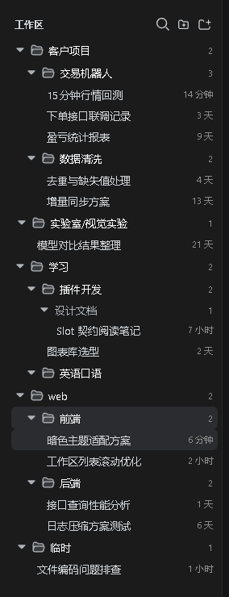
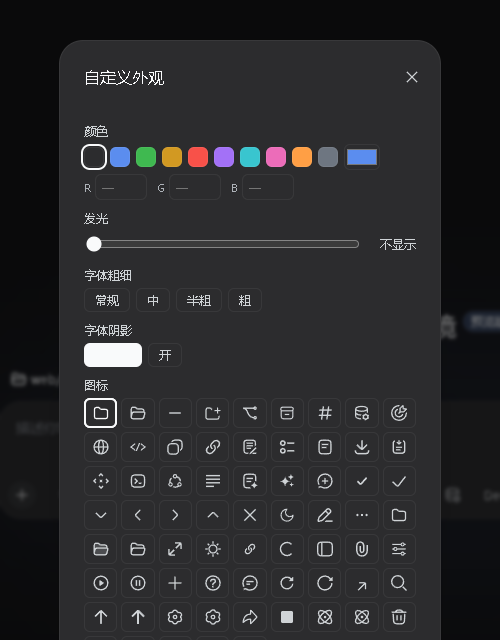
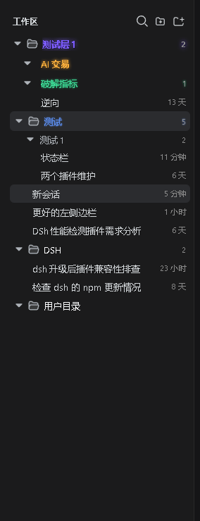
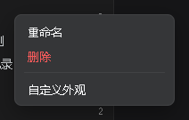
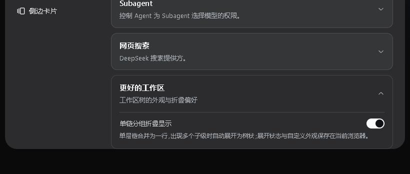

# dsh-better-workspace

[](https://awesome-dsh-plugin.com)

[简体中文](README.md) | English

> A **two-layer folder system** for the DeepSeek Harness (DSH) sidebar workspace list — a **disk layer** nests workspaces by their directory paths (the official workspace-tree semantics: a workspace inside another workspace's directory nests under it), and a **name layer** eats every `/` in workspace titles (`web/frontend` and `web/backend` under one virtual `web` folder). The two layers combine orthogonally.

```
disk layer (paths, automatic)         name layer (titles, virtual)
~/projects/                           web/
|- web/        <- workspace (dir)     |- frontend  <- workspace "web/frontend"
|  `- api/     <- nested workspace    `- backend   <- workspace "web/backend"
`- docs/       <- sibling workspace
```

## Features & preview

<table>
<tr>
<td align="center" width="58%"></td>
<td valign="top"><b>Hierarchical tree</b><br/>Every `/` in a workspace title creates a virtual folder: web/frontend and web/backend sit under one web group, arbitrarily deep; workspaces without a `/` stay at the root. Renaming a workspace re-derives the tree <b>instantly</b> — folders are a projection of names, there is no second source of truth.</td>
</tr>
</table>

### Add workspace: the official directory flow

"Add workspace" runs the **official DSH picking flow** (since v0.12.0): a loopback-only webserver bind with a display session opens the host's **native OS chooser**; an all-interfaces/LAN bind, an SSH launch, or a headless host switches to the official **in-app directory browser** (Miller columns, root-anchored breadcrumbs, editable path, inline new-folder row, hidden-file toggle) — the exact scenario this plugin's hand-rolled browser polished until the official one landed. Picking a directory creates the workspace and starts a new session in it, exactly like the shipped browser; the conversation empty-state picker drives that same official flow from this plugin's tree popover (v0.22.0).

Grouping happens by naming, not by a popup: rename the workspace after creation (every `/` in the title is a group) or drag it onto a folder row.

### Groups: a projection of names

Name groups derive from the `/` segments of workspace titles — there is no second source of truth to keep in sync. Right-click a folder row to **rename the group** (rewrites the title prefix of every member); the tree re-flows instantly. The root level holds workspaces without a `/`.

### Sessions follow the same rule

Session titles nest on `/` too (e.g. `test1/plugin maintenance`). Session groups render in a secondary color without a folder icon, so they are clearly distinct from workspace folders; a session group can be renamed as a whole (rewrites member titles).

**No title regression after a restart**: the cold list right after a DSH restart only carries titles for sessions that hit the persisted projection cache — fork-born and never-checkpointed sessions temporarily fall back to the workspace *basename*, even though the real title still lives in the session log. This plugin remembers each session's **last real wire title** in the browser (a debounced local cache: real changes coalesce into one write) and renders from memory during that window, so `/` grouping keeps working; the moment a session opens, the official data takes over and self-heals.

**Settings and appearance**: appearance, the default appearance, and toggles persist for the current DSH profile; collapse state and the local session order stay per-browser.

<table>
<tr>
<td align="center" width="58%"></td>
<td valign="top"><b>Appearance customization</b><br/>Right-click any row (workspace folder / workspace / session / session group) → Customize: color (swatches + picker + RGB), glow strength (0–14 slider, text only), font weight, font shadow, a <b>text outline</b> (toggle + 0.5–4px width, <b>off by default on fresh installs</b> — on a clean theme the rim reads as embossed noise, so turn it on when a background image needs it; its color is gray by default, with black / white / any-color picker and an Auto mode that derives the contrasting pole from the row's font color — light text gets a black rim, dark text a white one — following the theme or a background plugin's light/dark switch. Upgraded installs keep the outline they had), an icon grid (69 icons from the dsh primitives family or any emoji, split into Default / Emoji tabs; workspace &amp; folder rows only), with a live preview at the bottom. Reset returns to default in one click.</td>
</tr>
<tr>
<td align="center" width="58%"></td>
<td valign="top"><b>Applied immediately</b><br/>Color, text glow, font weight, shadow and icon apply per row and persist, together with expansion state, via the dsh client store in the current browser.</td>
</tr>
</table>

<table>
<tr>
<td align="center" width="58%"></td>
<td valign="top"><b>Context menu everywhere</b><br/>Actions live in the right-click menu: workspace rows — rename / show in folder / delete workspace / <b>filter sessions</b> (archived visibility, since v0.40.0) / customize; folder rows — rename group (updates all descendant workspaces) / customize; session &amp; session-group rows — rename / fork / archive / customize; session rows also get <b>Copy Session ID</b> (v0.30.0, mirroring dsh 0.2.1-alpha.5's fifth official menu entry — the clipboard write rides the host primitive, with a notice either way).<br/><b>Since v0.38.0 the shared host context menu owns session/workspace rows</b>: official entries and this plugin's extras (move to group / move out / customize / default preset, after a separator) share one popup, and future official entries appear automatically; group rows keep the plugin menu.<br/><b>Since v0.40.0 workspace rows add a “Filter sessions” submenu</b>: Follow global (default) / Hide archived / All conversations (show archived) / Archived only. The pick changes only that workspace, never the global filter, and every other workspace stays as it is.<br/><b>Since v0.40.2 the official workspace “Rename / Delete workspace” requests are consumed by this plugin's local dialogs</b>: once the custom sidebar shadows the shipped browser, the official dialogs never mount, so those menu items used to do nothing; confirm, cancel and failure all settle the request.</td>
</tr>
</table>

<table>
<tr>
<td align="center" width="58%"></td>
<td valign="top"><b>Settings card</b><br/>Settings → Plugins → Configuration adds a “Better Workspaces” card (official accordion style) with a <b>single-child-chain merge</b> toggle (e.g. level1 containing only AI trade renders as one row level1/AI trade) and a <b>status breathing light</b> toggle (status dots hidden by collapse bubble outward as breathing glows; on by default); a <b>default appearance</b> section configures color / glow / weight / shadow / outline toggle / outline width once for every row that was never customized (the outline ships off on fresh installs, the rest matches “no customization”); a <b>Hide older sessions</b> window (off / 3 / 7 / 14 / 30 days, a pure view filter) is right below. Settings persist for the current DSH profile; expansion state and styling additionally persist via the dsh client store in the browser.</td>
</tr>
</table>

### More highlights

- **Folder-style collapse**: clicking a workspace row collapses/expands all of its sessions (the row keeps a session counter when collapsed); session groups collapse too; search force-expands everything.
- **Hide older sessions (v0.41.0, PR #21)**: the settings card offers Off / 3 / 7 / 14 / 30 days. Sessions not updated within the window are hidden from the view only — nothing is archived and no session data is rewritten; choosing Off restores them immediately. The current session, pinned sessions, running / waiting / just-completed sessions, sessions with subagents, and blank placeholders always stay visible, and a search shows everything. Workspace counts, the flat list and the Ungrouped bucket follow the same window.
- **Native drag restored**: drag a workspace row above/below another to reorder (writes back the host registry order) or onto a folder row to move it into that group (rewrites the title prefix); drag session rows to reorder inside their group, onto a row of ANOTHER group to move into that group (onto a root-level row to leave the group), onto a session-group row to move into it, or onto their OWN workspace row / anywhere outside a group (empty space included) to leave it — the workspace row highlights and the tree shows a faint dashed hint while such a drag is in flight; a grouped session row also offers "Move out of group" in its context menu. Display order = host manual order, drag results are visible immediately. **The disk layer is a filesystem fact and never changes through dragging**: a cross-level drop only re-groups the name prefix (the workspace lands at the end of its own disk level), same-level drops take the anchor order. While dragging a workspace, merged single-chain rows (e.g. work/A) temporarily re-expand into folder rows — every level of the path becomes a drop target, and chains merge back when the drag ends.
- **Native capabilities kept**: open/rename/fork/archive sessions, per-workspace new-session (the + button always expands the workspace first so the new session is immediately visible), current-session highlight, official status dots (blue running ring / amber pending / green done), **status breathing lights** (dots hidden by collapse bubble outward: workspace/folder rows breathe on their icon in the status color — amber pending / green done, custom-glow labels breathe along; running breathes blue only on the session row itself and never relays; off-able in settings), **active-schedule badge** (alarm clock icon for sessions with active Schedule records; since v0.23.0 it renders the occupant of the shipped `sidebar.session.row.leading` seat, so it is the same mark the official row would show), ungrouped-session fallback, UI copy in 21 languages following the DSH language preference (Simplified and Traditional Chinese included).
- **Auto color + icon for new items (v0.25.0, off by default)**: one switch in the plugin settings card. Turn it on and every newly created session gets a built-in color while every new workspace additionally gets an icon — for anyone who would rather not style rows one by one. Colors come from **13 fixed slots**, each shipping **two colors** — a darker one for the light theme, a lighter one for the dark theme — drawn with a shuffle bag plus a recent-draw window: nothing repeats inside a cycle, a refill never starts with the last three colors, and items added in a row look clearly different. **The readability claim is real**: every entry keeps contrast **≥ 4.5** on its own theme's background, i.e. WCAG **normal-text AA** (computed by script and asserted per color in the test suite, measured against conservative surfaces: a hovered row darker than pure white in the light theme, the brightest surface in the dark theme). A row stores the **slot id (`auto:3`), not a hex**, so **switching between light and dark repaints it with the matching sibling color** — nothing to reconfigure and no mismatch. **Only items created after you turn it on are touched**: rows you styled by hand (stored as hex) are never overwritten, turning it off does not undo assignments, and an item is never randomized twice. Icons come from the existing icon candidate set, filtered by what the host actually exports — and **workspaces only**: the session row's cell belongs to the official status dot and schedule mark, so it has no icon slot.
- **Emoji icons with tabs (v0.42.0, #24)**: the icon section of the appearance panel is split into **Default** and **Emoji** tabs. Default keeps the dsh-primitives candidates; Emoji offers 66 common glyphs plus a free-form field for any emoji (up to 24 UTF-16 units, plain text rejected), applied live to the preview. Values are stored as `emoji:<char>`, so they never collide with icon names, and survive reloads and theme switches. Icons still apply to workspace and workspace-folder rows only.
- **Coexists with session-provider icon plugins (v0.42.0, #23)**: three DOM contracts expected by `dsh-sidebar-session-provider-icon` are now preserved (session-row class token, title class order, and the `session:` row key), so its MutationObserver-injected provider badge appears before session titles. The other plugin needs no change, and the existing row layout is unaffected.
- **Official semantics and shortcuts wired up (v0.23.0, aligned with dsh 0.1.7-rc.2)**: ① the archived filter is the shipped three-way pick (**Hide archived** / **All conversations (show archived)** / **Archived only**); under "Archived only" a workspace without archived sessions disappears entirely, and an empty list offers "No archived sessions yet" + **View other sessions** as the way back. ② The shipped shortcuts **⌥⌘K search / ⌥⌘O add workspace / ⌥⌘N new session** (⌘K / ⌘O / ⌘N on desktop) really work in this plugin's own sidebar — the search key opens and focuses this sidebar's filter field, the add key runs the very same official directory flow (native chooser on a native host, the in-app pointer on a browse host), and the buttons show the host's current keybindings. ③ A first-use workspace reads as the localized "Default workspace" instead of the on-disk directory name. ④ **Since v0.40.0 a workspace's right-click “Filter sessions” submenu can override those three states per workspace** (Follow global / Hide archived / All conversations / Archived only): the default follows the global filter, the override touches only that workspace (neither the global pick nor other workspaces move), and a workspace that chose “Archived only” while holding no archived sessions keeps its empty row so the same menu can switch it back.
- **Automatic titles never nest; only your explicit grouping does (v0.39.2, issue #19)**: the host records where each title came from (`source.kind` on `session/title`). This plugin carries that provenance to the sidebar through the `betterWorkspace/titleSource` summary projection: a **`fallback` / `provider` auto-title is always ONE row, no matter how many `/` it contains** (no synthetic `“”` wrap and no 20-second rename). A `/` becomes a hierarchy only after you **rename the session, drag it into a group, or rewrite its group prefix** — the source then becomes `user`. A fresh session therefore stays a single row from birth, even when its echoed first message or a path used to shred it into fake folders. When the projection is missing (old cold cache, registration unavailable) the display keeps its text fallback: titles quoting an absolute path or a `~` / `./` / `../` path stay flat; paired quotes protect a `/` inside them; a quoted span with no slash is ordinary text. No session data is migrated or lost. Session grouping stays on by default; turn it off in the view menu if you don't want it.
- **The New Session workspace picker IS the sidebar tree (v0.22.0)**: the empty-state "Workspace" chip used to open the shipped one-level list of flat titles (no disk nesting at all). This plugin shadows that seat (lowest priority renders) and draws the **same** tree the sidebar draws — disk nesting, the tri-state "/" name layer, chain compression — all from the one view store, so changing a view option on the sidebar moves this popover immediately. The current workspace carries a check, folder rows fold (picker-local, fully expanded by default), and the pinned "Add workspace" action still renders the **shipped directory-picking occupant** (native chooser / official in-app browser) instead of a copy.

## Install

```bash
dsh plugin --profile web add dsh-better-workspace
```

Plain JavaScript, zero build, zero npm dependencies (dsh client baseline modules only). Restart DSH after installing.

## How it works

The sidebar browsing region is the public `sidebar.workspaces` slot; this plugin registers the same slot with a lower priority and replaces the shipped browser with the tree. All data flows through the slot’s standard snapshot hooks and injected host actions. The one exception is **renaming a closed session without opening its history**: rc.1 only exposes `sessions.binding` / `sessions.using` (`using` opens history), so the fast path still reads `sessions.manager`. The code marks it **PRIVATE BRIDGE**; remove it as soon as the host makes that path public.

The add flow is entirely official. This plugin **does not declare** either directory-flow child hole (child-hole declaration is exclusive, and the entry that shadows the seat cannot receive `renderSlot` authorization). The sidebar probes the backend: `native` calls the official `pickDirectory()`; `browse` reads the official occupant from the slot ledger (component plus its own inject face), supplies the owner callback contract (open / busy / onPicked / onCancel / onError), and renders it directly. The conversation empty-state picker uses the same reading. The official composed occupant (native chooser / in-app browser) owns the whole picking interaction; this plugin, as the owner, just creates the workspace and starts a session after the pick. Requires dsh >= 0.2.2-rc.1.

View state (folder collapse, session expansion), custom styling and plugin settings persist browser-side via the dsh client store (`dsh.betterWorkspace.view.v1`).

## Relationship to dsh-better-sidebar

Same `dsh-better-*` family, zero overlap: [dsh-better-sidebar](https://github.com/omdsh-dev/DSH-better-sidebar) is the VSCode-like panel on the right; this plugin only takes over the left workspace list. They can be installed together.

## Version compatibility

- **Runtime floor: dsh >= 0.2.2-rc.1, Node.js >= 24.9.0.** Since v0.39.0 this plugin maintains only this host generation; it keeps no probes or fallbacks for 0.1.x / 0.2.0 / 0.2.1 / pre-rc.1 0.2.2 prereleases.
- **rc.1 contract**: the global standard hooks are `useSessionStatus` / `useSessionAccess`; session/workspace rows use the shipped `contextMenus`; session rows render the shipped `sidebar.session.row.trailing` and `sidebar.session.row.leading` seats; settings register only the official `plugins.bundle.config` seat.
- **rc.2 contract**: the shipped `Menu` dropped `getAnchorRect` in favour of `anchorRef` (element anchor) and `anchorPoint` (coordinate anchor). Both popovers send the old and new props, so positioning works on rc.1 and rc.2 alike; the `openWorkspaceMenu` / `openSessionMenu` injections removed from `ui-workspace` were never used here, and the optional `{button}` argument on `contextMenus.open` plus the new `hoc` slot kind leave the existing paths untouched.
- **Settings persistence**: the plugin Config exposes only four volatile fields — `compactChains` / `statusPulse` / `styling` / `appearance`; other view preferences stay in the browser-local store and are never written to the host. Manual cross-device sync is gone with the shared `settings.yaml` era.
- **User-data migration**: old snapshots with `workspaceTitleSlash`, a missing `stroke` key, or retired icon names are still read with per-era defaults, so upgrading never changes existing grouping or appearance. This compatibility covers **this plugin's own old data only**, not old hosts.

## Limitations / roadmap

- Dragging a session **across workspaces** is still refused (a session belongs to its workspace); inside one workspace the group now follows the drop (v0.18.0: another group's row rewrites the prefix, the workspace row takes it out of every group, and the context menu offers "Move out of group").
- Search is local title filtering (both layers flattened, per-workspace matching); host content search (`session.search`) is planned.
- The flat view is not taken over; the hierarchical tree is the view.

## Develop

```bash
npm test        # smoke: manifest consistency / baseline require whitelist / dictionary alignment / syntax
npm pack        # tarball for local install verification
```

## License

[MIT](./LICENSE)
